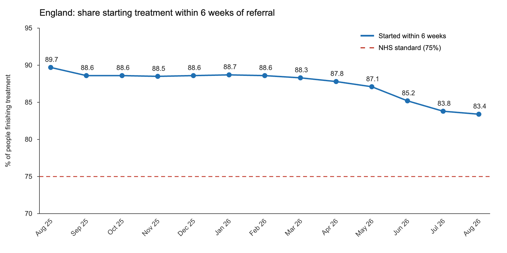
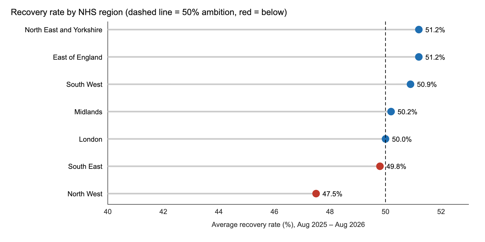

# NHS Talking Therapies – SQL Analysis (Aug 2025 to Aug 2026)

I wanted a project with real NHS data, so I used the official **NHS Talking Therapies** monthly statistics from NHS England. NHS Talking Therapies is the free NHS service for anxiety and depression in England.

I loaded 13 months of data (183,722 rows) into SQLite and used SQL to answer five simple questions:

1. Are people starting treatment quickly enough?
2. Are people getting better after treatment?
3. Which regions and local areas do well, and which fall behind?
4. How does my local area, Bradford, compare with England?
5. How much of the data is hidden, and how does that affect the analysis?

**Tools:** SQL (SQLite), Python (loading the data and making the charts), DB Browser for SQLite

---

## Key findings

### 1. Waiting times: still above the standard, but getting worse
The NHS standard is that **75%** of people start treatment within 6 weeks of referral.

- England met the standard in every month.
- But the share fell from **89.7% in August 2025 to 83.4% in August 2026**, a drop of 6.3 percentage points.
- Most of the drop happened after April 2026 (87.8% → 83.4% in four months). If this trend continues, the gap to the standard will keep getting smaller.
- The 18-week standard (95%) was met every month (97.5% to 98.9%).



### 2. Recovery: England sits right on the 50% ambition
The NHS ambition is that at least **50%** of people who finish treatment recover.

- England's monthly recovery rate was between **48.6% and 51.2%**. It reached 50% or more in 7 of the 13 months.
- About **2 in 3** people (66.5% to 68.7%) showed *reliable improvement*, even when they did not fully recover.
- Around **6%** got worse (reliable deterioration). This was steady across the year.

### 3. Regions: the North West is behind on recovery and on access



- **North East and Yorkshire** and **East of England** had the highest average recovery (51.2%).
- **North West** was lowest at **47.5%**, and **South East** was just under at 49.8%.
- The North West also had the **lowest share of referrals that started treatment**: 58.6 per 100 referrals, compared with 71.0 in North East and Yorkshire.
- Of the 10 local areas (Sub-ICBs) with the lowest recovery, **8 are in the North West** (Greater Manchester, Lancashire and South Cumbria, Cheshire and Merseyside). The lowest was Greater Manchester – 01G at 37.5%, which is 12.5 points below the ambition.

### 4. Only about 6 in 10 local areas meet the ambition
Each month, only **51% to 69%** of local areas reached 50% recovery. The best month was March 2026 (68.8%).

So the England average of around 50% hides big differences between areas.

### 5. Bradford is a little above England
Bradford District and Craven (Sub-ICB 36J) averaged **51.1%** recovery. It was above England in **11 of the 13 months**.

---

## About the data (and its limits)

- **Source:** NHS England Digital, *NHS Talking Therapies Monthly Statistics, Performance August 2026*, "Monthly Time Series for Key Measures". Open Government Licence.
- **Format:** It is in "long" format: one row per area, per month, per measure. In most queries I used `CASE WHEN` to turn the measures into columns.
- **Hidden values:** NHS replaces small numbers with `*` to protect patient privacy. My first query checks how much is hidden:
  - 82% of the most detailed level (Sub-ICB × provider) is hidden, so I did **not** use that level.
  - Only 4% of Sub-ICB rows and 1.4% of region rows are hidden, so those levels are reliable enough.
- **Averages:** The regional and local averages are simple averages of the monthly percentages, not weighted by the number of patients.
- **Referrals vs started treatment:** The people who started treatment in a month are not exactly the same people who were referred that month. So "started per 100 referrals" is a rough guide, not an exact conversion rate.
- **Rounding:** Sub-ICB percentages are rounded to whole numbers, and some counts are rounded to the nearest 5.

---

## Project structure

```
├── data/                  # put the NHS CSV here (not in the repo, too big)
├── sql/
│   ├── 01_data_overview.sql
│   ├── 02_england_monthly_trend.sql
│   ├── 03_waiting_times_vs_standard.sql
│   ├── 04_recovery_by_region.sql
│   ├── 05_subicb_below_recovery_ambition.sql
│   ├── 06_share_of_areas_meeting_ambition.sql
│   ├── 07_bradford_vs_england.sql
│   └── 08_referrals_to_treatment.sql
├── results/               # output of each query as CSV
├── images/                # charts used in this README
├── load_data.py           # loads the CSV into SQLite
├── run_queries.py         # runs every .sql file and saves the results
└── make_charts.py         # makes the two charts
```

## How to run it

1. Download the CSV (link in `data/README.md`) and save it in the `data/` folder.
2. Run:
   ```
   python load_data.py
   python run_queries.py
   pip install -r requirements.txt
   python make_charts.py
   ```
3. You can also open `talking_therapies.db` in **DB Browser for SQLite** and run the `.sql` files there.

## SQL skills used
`GROUP BY` and aggregates · `CASE WHEN` to pivot long data into columns · CTEs (`WITH`) · self-join (Bradford vs England on the same table) · filtering out hidden values (`NULL`) · `ROUND`, `CAST`, `REPLACE`

## What I would do next
- Build a Power BI dashboard on the same data, with a filter for each region and local area.
- Add the *activity* file to look at waiting times for each local area, not only for England.
- Check whether areas with longer waits also have lower recovery.

---
*Rumeysa Camur · MSc Applied AI & Data Analytics (University of Bradford) · Microsoft Certified: Power BI Data Analyst (PL-300)*
